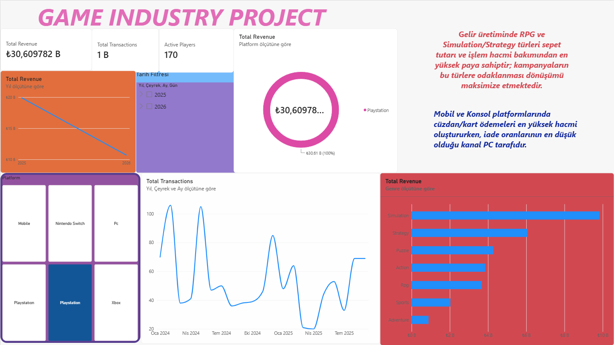

# 🎮 Game Industry Analytics | Power BI Dashboard

Bu proje, 2 günlük yoğun Power BI eğitimi kapsamında tamamlanan oyun sektörü satış ve oyuncu analitiği çalışmasıdır.

## 📊 Dashboard Önizleme

## 📌 Proje Kapsamı
- **Power Query (ETL):** Veri tipi dönüşümleri, metin standardizasyonu ve eksik veri temizliği.
- **Veri Modelleme:** Players, Games ve Purchases tabloları arasında Star Schema mimarisinde 1-to-many ilişkiler.
- **DAX Ölçüleri:** 
  - `Total Revenue` (Tamamlanan sipariş cirosu)
  - `Total Transactions` (Başarılı işlem hacmi)
  - `Active Players` (Tekil kullanıcı sayısı)
  - `ARPU` (Oyuncu başına ortalama gelir)
- **Görsel Analiz:** Tür, platform ve tarih dinamikleriyle interaktif filtreleme.

## 📁 Dosyalar
- `*.pbix`: Power BI çalışma dosyası
- `*.xlsx`: Ham veri seti
